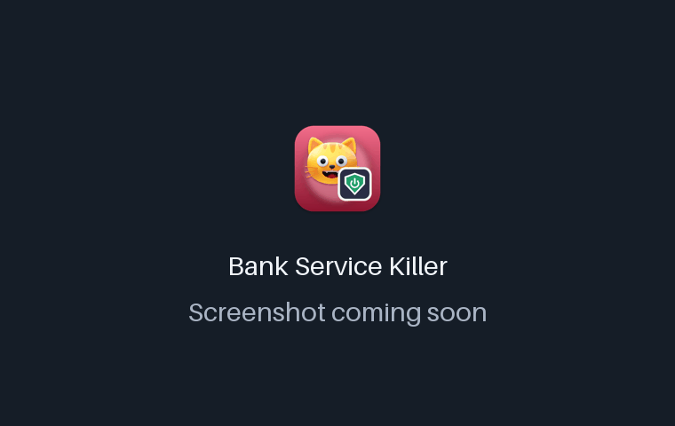
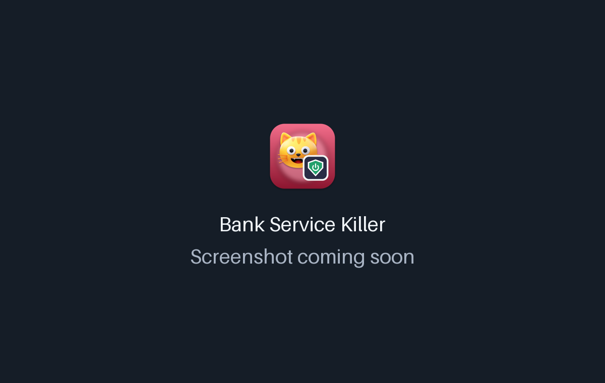

<!-- From jejezz/application-release-templates common/tool/readme @ conventions-v1.
     Generated by tool/readme/init_readme.py — see conventions/readme-guide.md.
     Fill every {{TODO: …}}; tool/readme/check_readme.py fails while any is left. -->

<p align="center">
  
</p>

<h1 align="center">Bank Service Killer</h1>

<p align="center">
  A <b>Windows service on/off tool</b> that turns banking and keyboard security services on only when you bank, and verifies they really changed state.
</p>

<p align="center">
  <a href="https://github.com/jejezz/bank-service-killer/releases/latest"></a>
  <a href="https://github.com/jejezz/bank-service-killer/releases"></a>
  
  
  <a href="LICENSE"></a>
</p>

<p align="center">
  <b>English</b> · <a href="README.ko.md">한국어</a>
</p>

<p align="center">
  
</p>

## Features

- **Service matching** — maps your watch list to installed services (Win32_Service), exact name first, then partial match
- **Turn on/off with verification** — polls the real state after each command; a stop is re-checked after 3 seconds to catch watchdog processes that restart the service
- **Startup type** — switch between Automatic, Manual and Disabled; services disabled in msconfig are flagged
- **Editable watch list** — add installed services with `+`; the list lives in `%APPDATA%\BankServiceKiller\watchlist.json` and can be edited by hand
- **Light & dark, English & 한국어** — follows the system, or pick one in the toolbar

<p align="center">
  
  
</p>

## Install

Download from [**Releases**](https://github.com/jejezz/bank-service-killer/releases/latest):

| OS | File |
|---|---|
| Windows 10/11 (x64) | `BankServiceKiller-<version>-windows-x64-setup.exe` |

**Windows:** the installer isn't code-signed yet, so SmartScreen says "Windows protected your PC" — choose **More info → Run anyway**.

## How it works

There is no native code: Dart calls `sc.exe`, PowerShell (`Get-CimInstance Win32_Service`) and `reg.exe` directly. Controlling services needs administrator rights, so the app manifest requests `requireAdministrator`.

## Development

```bash
flutter pub get
flutter run -d windows
```

You need Windows with the Flutter desktop toolchain (Visual Studio C++ workload). The app requests administrator rights, so run `flutter run` from an elevated terminal.

Releasing: `scripts/bump-version.sh patch`, merge, then tag `vX.Y.Z` — CI builds and publishes the Windows installer. Rules: [application-release-templates/conventions](https://github.com/jejezz/application-release-templates/tree/main/conventions).

## Credits

- Font: [SeoulNamsan](https://www.seoul.go.kr/seoul/font.do) (Seoul Metropolitan Government)
- Icons: [Icons8](https://icons8.com)

## License

[MIT](LICENSE) © 2026 Jongyun Ahn
